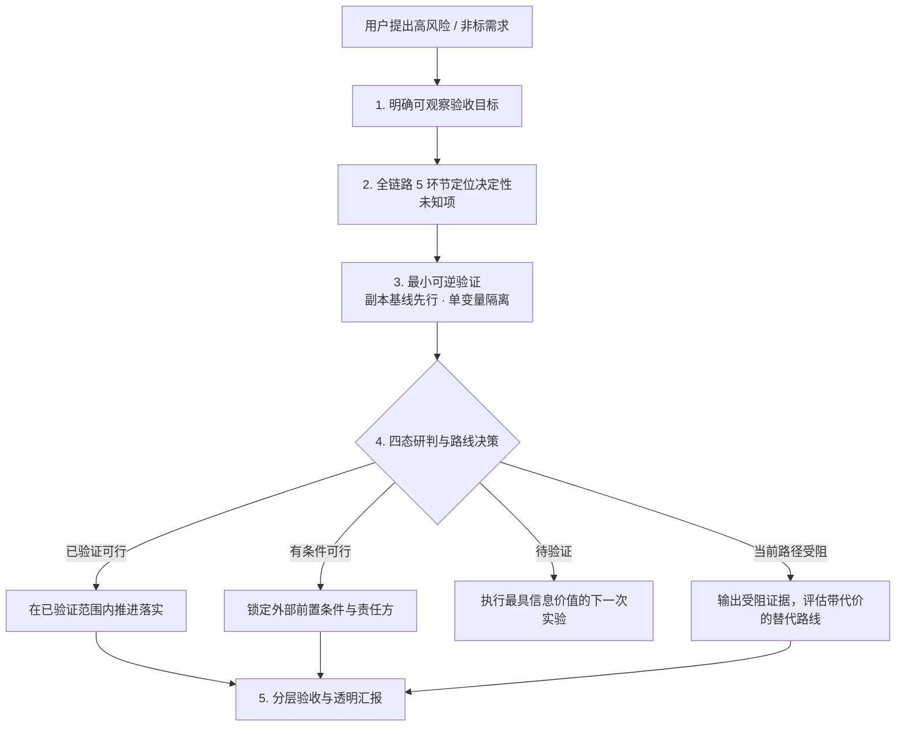

<p align="center">
  <h1 align="center">AI_Edge</h1>
  <p align="center">
    <strong>AI 任务可行性门禁 · 能力边界排雷 · 全链路交付闭环 Skill</strong>
  </p>
  <p align="center">
    <a href="#english">English</a> · <a href="#zh-cn">简体中文</a>
  </p>
  <p align="center">
    
    
    
  </p>
</p>

---

<a id="zh-cn"></a>

## 目录

- [一、为什么需要 AI_Edge](#一为什么需要-ai_edge)
- [二、核心哲学与防翻车准则](#二核心哲学与防翻车准则)
- [三、全链路五步闭环工作流](#三全链路五步闭环工作流)
  - [1. 明确验收目标](#1-明确验收目标)
  - [2. 定位决定路线的未知项（全链路五环节）](#2-定位决定路线的未知项全链路五环节)
  - [3. 先做最小可逆验证](#3-先做最小可逆验证)
  - [4. 四态研判与路线决策](#4-四态研判与路线决策)
  - [5. 分层验收与透明汇报](#5-分层验收与透明汇报)
- [四、经典实战案例：拳皇 97 ROM 改造排雷](#四经典实战案例拳皇-97-rom-改造排雷)
- [五、触发边界（何时使用，何时不使用）](#五触发边界何时使用何时不使用)
- [六、安装与使用方式](#六安装与使用方式)
- [七、项目目录结构](#七项目目录结构)
- [八、License](#八license)

---

## 一、为什么需要 AI_Edge

在软件研发进入 Agent 时代的今天，大语言模型（LLM）在面对常规 CRUD、标准 API 调用和常见前端页面时表现优异。但在处理**高未知度、非标改造、封闭系统、逆向工程、固件/ROM 修改、或跨复杂异构环境部署**的任务时，传统 Agent 经常陷入两种极端死局：

| 极端表现 | 行为特征 | 产生的灾难后果 |
| :--- | :--- | :--- |
| **极端一：盲目承诺（画饼型）** | 遇到用户提出的非常规目标，不探查底层校验与工具链，满口答应“能做”、“很快搞定”。在没有验证基线的情况下写一堆不可运行的代码。 | 耗尽数万 Token 与大量时间后半路卡死，或者将黑屏、编译失败谎报为“已搞定”，让用户在实机验收时彻底翻车。 |
| **极端二：过早否定（甩锅型）** | 一旦遇到工具链缺失、某次命令报错或看到黑屏，未定位根因就主观断言“大模型做不到”、“行业技术不可行”、“必须全部重写”。 | 把原本只需要改动一处偏移量或补全格式转换的任务全盘推翻，给用户带来巨大沟通成本与错误决策。 |

**AI_Edge** 正是为解决这一结构性痛点而设计的 **Agent 可行性门禁与全链路排雷雷达**：

> **“在大量投入前找到决定路线的证据，在交付时说明实际验证到哪里。避免盲目承诺，也避免在证据不足时过早否定。”**

---

## 二、核心哲学与防翻车准则

1. **证据驱动，拒绝推测**：
   - 区分“事实”（实际命令输出、文件偏移、日志报错）、“推断”（基于格式规范的合理猜测）与“待验证假设”。
   - 严禁把“预期结果”当作“实测证据”。
2. **区分概念级差异，不混淆安全机制**：
   - **CRC / 校验和 / MD5 哈希** $\neq$ **数字签名**。重新计算 CRC 绝不能绕过带公私钥信任根的数字签名。
   - 缺少官方工具链 $\neq$ 无法解析或重建；存在第三方工具 $\neq$ 兼容当前目标版本。
   - 宿主拦截、黑屏崩溃或一次启动失败只是“症状”，不能在未隔离变量的情况下直接推断“CRC 拦截”或“路线不可行”。
3. **保持范围严谨性（Scope-Bounded Claims）**：
   - “最小单例验证通过” $\neq$ “项目已完成”。
   - 占位素材、Mock 数据、空实现可以用于受控实验，严禁冒充最终生产交付。

---

## 三、全链路五步闭环工作流



### 1. 明确验收目标

- **提取要素**：交付物形态、目标运行环境/硬件版本、用户实际使用入口、质量要求与预算。
- **确立可观察的验收标准**：例如“在指定 WinKawaks 模拟器中双击启动，在选人界面看到新增头像，选定后能进入对局并释放核心招式”。
- **明确边界**：严格区分原型 Demo、局部验证与端到端完整交付，锁死必须保留的平台与功能约束。
- **信息补全策略**：仅询问会直接改变技术路线且无法通过代码或逆向查明的信息；其余标为“暂定假设”并独立推进。

### 2. 定位决定路线的未知项（全链路五环节）

涉及具体产物修改与交付时，AI_Edge 启动五维排雷矩阵，按链路穿透阻碍：

| 环节 | 核心决定性问题 | 最小验证手段与证据类型 | 常见致命雷区 |
| :--- | :--- | :--- | :--- |
| **① 输入与修改** | 输入是否完整？能否准确定位目标？受否受地址、结构体对齐或容量上限硬约束？ | 逆向提取已知资源字段；尝试修改一个已理解的独立逻辑点或纹理块。 | 以为修改了文本即改了逻辑；未注意定长数组或紧凑排布导致的越界崩溃。 |
| **② 构建与打包** | 修改后如何生成符合格式的有效产物？是否依赖闭源私有工具链、特定重定位算法？ | 验证“解包 $\rightarrow$ 不改动任何内容 $\rightarrow$ 重新封包”产物能否在基准环境正常加载。 | 闭眼修改文件后发现无法打回打包格式，或者解包工具打乱了内部字节序。 |
| **③ 运行环境** | 产物能否在目标硬件、架构、操作系统及指定启动参数下工作？ | 在未修改的原始基线上测试启动并记录正常日志；建立基线对照。 | 本地跑通（如 Wine / x86）就假定目标 ARM/真机环境一定能跑通。 |
| **④ 校验与加载** | 谁在执行完整性检查？是提示警告、悄默拒载还是崩溃？是哈希、CRC 还是公钥私钥签名？ | 查阅对应版本系统加载机制；受控改变 1 字节测试宿主反应。 | 误把数字签名当成 CRC32；在不可控宿主上死磕修改宿主而不是寻找合法扩展点。 |
| **⑤ 用户验收** | 从约定的真实入口操作，能否顺畅完成端到端核心交互？ | 真实环境下从双击启动到核心流程走通，保存或正常退出。 | 只以“单元测试通过”或“导出了一张图片”冒充整体业务可用。 |

### 3. 先做最小可逆验证

- **最高风险优先**：优先设计实验验证一旦失败就彻底颠覆路线的环节，坚决避免先做大量边角料工作。
- **基线先行原则**：**优先在副本上验证未修改基线**。基线若本身报错，先排查环境与依赖，严禁在故障基线上直接改代码。
- **单变量原则**：一次只改变一个因素，尽量做可回滚的微小改动。
- **标准化实验记录四要素**：
  1. **假设与用途**：本次验证什么？结果将如何决定路线？
  2. **输入与范围**：使用什么测试文件、工具版本、基线配置。
  3. **操作与预算**：具体执行的 CLI 命令，设置明确的超时与重试上限。
  4. **观察与结论**：记录成功/失败的原始输出，明确指出证据文件位置与未覆盖范围。

### 4. 四态研判与路线决策

任何时候向用户同步进展，结论必须落在以下四态之一，且**必须附带生效范围**：

| 状态判定 | 触发条件与证据要求 | 下一步行动准则 |
| :--- | :--- | :--- |
| 🟢 **已验证可行** | 已有确凿实验证据完全支持声明范围内的关键链路。 | 在该范围内全力推进并做端到端最终验收。 |
| 🟡 **有条件可行** | 技术路线已被证据支持，但剩余条件明确（如需要特定私钥、依赖物理设备、需付费授权）。 | 清晰列出前提条件、责任方与满足方案，由用户决策是否提供外部条件。 |
| 🔵 **待验证** | 核心机制尚未查明，证据不足或正反两方实验相互冲突。 | 执行最具信息价值的下一次最小探针实验，不妄下断言。 |
| 🔴 **当前路径受阻** | 确凿证据证明在当前给定约束条件下必要前提无法满足（如私钥签名拦截、硬件熔丝阻断）。 | 说明具体受阻节点，提供附带代价的替代路线（如降级方案、更换宿主）。 |

### 5. 分层验收与透明汇报

汇报时力求紧凑精炼，杜绝长篇空话，直击三要素：
- **目标**：交付物、运行环境、验收标准与约束。
- **研判**：当前状态（四态之一）、生效范围、支撑证据、剩余未知项。
- **行动**：本次实际完成的验证链路（修改/打包/加载/运行各阶段状态），以及下一步需用户决策的事项。

---

## 四、经典实战案例：拳皇 97 ROM 改造排雷

本仓库内置了关于封闭产物修改的实战案例分析：[`references/kof97-rom.md`](file:///d:/notebook/ai_edge/references/kof97-rom.md)。

### 案例背景
- **需求**：向《拳皇 97》NeoGeo ROM 中新增全新的原创角色，要求在特定模拟器（WinKawaks）中双击运行，进入游戏自由选用。
- **历史错误复盘**：早期 Agent 仅替换了一小块 Sprite 贴图，在未经模拟器全流程运行的情况下声称“修改完成”；用户实测直接黑屏或报错。随后 Agent 又急剧转向，断言“该模拟器必然 CRC 校验拦截，行业不可能做到，必须重写模拟器或改用 M.U.G.E.N 引擎”。

### AI_Edge 如何排雷与解构：

```
[盲目断言]                              [AI_Edge 科学排查]
“新增角色必然要重构地址总线”   ───────>  分析目标 ROM 结构体，区分“替换已有角色外观”与“新建槽位”
“没有官方工具链无法转图”       ───────>  逆向 NeoGeo 图形交织格式，用脚本对 16x16 Tile 做最小转换验证
“黑屏证明 CRC 拦截，必改模拟器” ───────>  先跑未修改基线，再做“解包->再封包”零改动测试，分离环境与校验因素
“改用 M.U.G.E.N 30 分钟搞定”   ───────>  明确指出替代路线打破了“原 ROM + 原模拟器”约束，需用户授权目标变更
```

通过这一案例，AI_Edge 规范了**从症状到根因**的严谨调查路径，杜绝了“假装完成”与“遇挫甩锅”。

---

## 五、触发边界（何时使用，何时不使用）

### ✅ 应当触发的场景
1. 用户输入明确指令：`/feasibility`、`评估可行性`、`帮我排雷`、`能力边界评估`。
2. 任务具备以下高风险特征之一：
   - 逆向工程、封闭系统固件 / ROM / 字节码修改。
   - 跨异构平台移植，且目标环境无法直接运行标准编译器。
   - 涉及未知的安全校验、数字签名、防篡改机制或驱动层依赖。
   - 任务在实施前存在一旦失败会导致全局返工的未知技术链路。

### ❌ 严禁滥用 / 无需触发的场景
1. 常规全栈开发（如标准 Spring Boot / React / Django / Vue 项目新增常规 CRUD 功能）。
2. 已有成熟官方构建文档和现成脚本的编译打包任务。
3. 纯概念咨询或问答，仅仅因为工作量大或用户口头问了句“能做吗”。
4. 已经在推进中且各环节证据链均正常的平稳实施阶段。

---

## 六、安装与使用方式

### 1. 安装到各类 Agent 工具

本仓库遵循通用 Agent Skill 规范，可直接集成进各种主流 AI 编程环境：

#### 安装到通用环境（Antigravity / Claude Code / Codex / Agents）：
```bash
# 全局安装（推荐）：
git clone https://github.com/hyl320/AI_Edge.git ~/.agents/skills/ai_edge

# 或仅在当前项目工程内安装：
git clone https://github.com/hyl320/AI_Edge.git .agents/skills/ai_edge
```

#### 安装到 Google Antigravity IDE：
将目录放置于全局技能目录或当前工作区插件目录：
```bash
# 复制或符号链接至技能目录
cp -r AI_Edge ~/.gemini/antigravity/skills/ai_edge
```

### 2. 对话触发示例

#### 方式 A：斜杠指令触发
```text
/feasibility 请评估能否在不修改固件签名校验的前提下，通过修改某设备配置文件开启 SSH 调试端口
```

#### 方式 B：自然语言显式触发
```text
我想把一个基于 Qt5 的闭源 Windows x86 桌面程序改造成能在 Linux aarch64 上运行。请用 AI_Edge 帮我做前置全链路排雷和可行性评估，列出决定性未知项和最小验证步骤。
```

---

## 七、项目目录结构

```text
AI_Edge/
├── SKILL.md                 # 核心技能定义与全流程执行协议（System Prompt）
├── references/              # 排雷参考指引与历史典型案例
│   └── kof97-rom.md         # 街机 ROM 改造与封闭产物排雷实战案例
├── README.md                # 完整技术架构与使用手册（中英双语）
├── LICENSE                  # 开源许可证 (MIT)
└── .gitignore               # 忽略配置
```

---

<a id="english"></a>

## English Overview

### Why AI_Edge?

LLM-driven coding agents frequently fail when tackling non-standard, closed-binary, or high-uncertainty engineering tasks. They either **overpromise** (writing tons of unverifiable code without checking underlying verification chains, only to collapse at delivery) or **prematurely quit** (attributing minor command errors or black screens to "impossible for LLMs" or "impossible in industry").

**AI_Edge** enforces an empirical engineering gate:
> *"Gather route-deciding evidence before heavy investment; report exact verified boundaries upon delivery. Avoid reckless commitments and premature denials."*

### Key Features
- **5-Stage Full-Link Matrix**: Triage across *Inputs & Modifications*, *Build & Packaging*, *Runtime Environment*, *Validation & Loading*, and *User Acceptance*.
- **Baseline-First Verification**: Always verify unedited baselines on replicas before altering bytes; isolate variables.
- **Strict 4-State Governance**: Categorize tasks only as `Verified Feasible`, `Conditionally Feasible`, `Pending Verification`, or `Current Path Blocked` with explicitly bounded scopes.
- **Root-Cause Attribution**: CRC/Checksums $\neq$ Digital Signatures. Toolchain absence $\neq$ Impossibility.

---

## 八、License

本项目采用 [MIT License](LICENSE) 开源协议。  
Copyright (c) 2026 [hyl320](https://github.com/hyl320).
